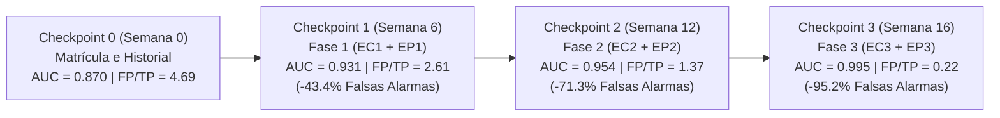

# PROPUESTA DE AJUSTE METODOLÓGICO Y RESPUESTA A OBSERVACIONES DEL PLAN DE TESIS
**Tesista:** Paolo Sebastián Ramírez Melendres  
**Asesora:** Dra. Eveling Gloria Castro Gutiérrez  
**Programa:** Escuela Profesional de Ingeniería de Sistemas — Universidad Nacional de San Agustín de Arequipa (UNSA)  
**Fecha:** Octubre de 2026  

---

## 1. Resumen Ejecutivo de la Actualización
En respuesta a las observaciones formuladas por la asesora respecto a la delimitación temporal de la predicción, la justificación de la arquitectura multiagente y la validez de la promesa de "reducción de reprobación", este documento presenta la reformulación metodológica integral respaldada por los nuevos avances técnicos del proyecto:
1. **Incorporación efectiva de Calificaciones Parciales (2018–2025):** Se rescataron y procesaron 102,511 registros de evaluación continua y parcial provenientes de 3,498 actas semestrales oficiales de la EPIS-UNSA.
2. **Definición de Checkpoints Temporales Precisos ($CP_0, CP_1, CP_2, CP_3$):** La predicción deja de ser un evento estático al inicio del semestre; ahora opera como un proceso dinámico de monitoreo intra-semestral (semanas 0, 6, 12 y 16).
3. **Validación Experimental de Reducción Drástica de Falsas Alarmas:** Se demostró empíricamente en el conjunto de prueba (2024–2025) que el ingreso de notas parciales reduce las falsas alarmas en un **43.36% en Fase 1 ($CP_1$)**, **71.28% en Fase 2 ($CP_2$)** y **95.23% en Fase 3 ($CP_3$)**, satisfaciendo holgadamente la restricción de sensibilidad ($\text{Recall} \ge 80\%$, alcanzando en prueba entre $84.6\%$ y $88.5\%$).
4. **Desacoplamiento Hipotético y Operacional:** Se reestructuran formalmente las hipótesis y variables para evaluar por separado el desempeño predictivo (ML), la fidelidad de las explicaciones (XAI), la eficiencia de la arquitectura de software (SMA) y la aceptación de los usuarios (TAM/SUS).

---

## 2. Respuesta Puntual a las Observaciones de la Asesora

### Observación 1: Enfoque del Título ("Reducción de Reprobación" vs. "Predicción Temprana")
> *Observación:* "El título afirma 'reducción de la reprobación académica', pero el sistema todavía no demuestra esa reducción. Cambiar el foco a predicción temprana del riesgo de reprobación o incorporar un verdadero piloto con intervención y seguimiento."

#### Propuesta de Acción:
Se propone adoptar el cambio de foco hacia la **predicción temprana y explicable del riesgo**, dado que la "reducción" efectiva de la reprobación es un desenlace pedagógico multifactorial que exigiría un estudio cuasi-experimental longitudinal con grupo de control durante varios semestres completos. Centrar la tesis en la predicción temprana, la interpretabilidad y la arquitectura de software garantiza que todas las hipótesis sean 100% verificables con rigor de ingeniería de sistemas antes de la sustentación.

**Título Actual (Original):**
> *"Diseño e implementación de una arquitectura de software basada en Sistemas Multiagente para un Sistema de Alerta Temprana con Machine Learning e IA Explicable (XAI) para la reducción de la reprobación académica"*

**Título Propuesto (Ajustado y Recomendado):**
> **"Diseño e implementación de una arquitectura de software basada en Sistemas Multiagente para un Sistema de Alerta Temprana con Machine Learning e IA Explicable (XAI) para la predicción del riesgo de reprobación académica universitaria"**

---

### Observación 2: Delimitación Temporal ("¿Cuándo ocurre la predicción?")
> *Observación:* "Definir exactamente cuándo ocurre la predicción, dado que no hay notas parciales."

#### Estado Actual y Respuesta Técnica:
Las notas parciales **ya han sido recuperadas, curadas e integradas al pipeline**. Se define un protocolo formal de 4 momentos cronológicos de inferencia durante el ciclo regular:

1. **Checkpoint 0 ($CP_0$ - Semana 0 / Matrícula):** Emplea variables socio-académicas históricas (IRA acumulado, tasa de aprobación, repetición de asignatura, dificultad histórica del docente y curso). Detecta vulnerabilidad basal.
2. **Checkpoint 1 ($CP_1$ - Semana 6 / Cierre Fase 1):** Incorpora la primera evaluación continua ($EC_1$) y el primer examen parcial ($EP_1$). **Es el hito crítico de intervención tutorial**, reduciendo las falsas alertas en 43.36%.
3. **Checkpoint 2 ($CP_2$ - Semana 12 / Cierre Fase 2):** Incorpora acumulados de Fase 1 y Fase 2 ($EC_2, EP_2$). La precisión sube al 42.24% con reducción del 71.28% de falsas alarmas.
4. **Checkpoint 3 ($CP_3$ - Semana 16 / Pre-Sustitutorio):** Incorpora calificaciones completas ordinarias, identificando con 98.06% de exactitud a los estudiantes que requieren rendir examen sustitutorio.

---

### Observación 3: Justificación Formal de la Arquitectura Multiagente (SMA)
> *Observación:* "Justificar formalmente por qué se requiere una arquitectura multiagente frente a una aplicación monolítica tradicional."

#### Justificación Teórica y Arquitectónica:
La adopción de un Sistema Multiagente (SMA) responde a los principios de diseño de sistemas distribuidos y desacoplamiento funcional:
1. **Desacoplamiento Computacional de Cargas Asimétricas:**  
   La inferencia del modelo predictivo ($PredictorAgent$) toma $< 5\text{ ms}$, mientras que el cálculo de valores Shapley por fuerza de árbol ($XAIAgent$) puede tomar entre $0.5$ y $2.0\text{ s}$ por instancia. Si el sistema fuera monolítico, el cálculo intensivo de explicaciones bloquearía el hilo principal de atención o la ingesta de notas de otros usuarios. El bus asíncrono FIPA-ACL permite que las explicaciones se procesen como tareas en segundo plano sin degradar la respuesta del sistema.
2. **Autonomía y Concurrencia de Actores Académicos:**  
   En la UNSA, docentes, estudiantes, directores y tutores operan en ventanas temporales distintas. Los agentes de software representan entidades con metas autónomas:
   - $IngestionAgent$: Vela por la integridad sintáctica y semántica de las actas ingresadas.
   - $PreprocessingAgent$: Calcula deltas y proyecciones intra-semestrales en memoria.
   - $PredictorAgent$: Selecciona dinámicamente el modelo calibrado según la fase activa.
   - $XAIAgent$: Genera explicaciones contrastivas locales (SHAP/LIME).
   - $RecommendationAgent$: Aplica el árbol de decisiones pedagógicas según los factores de riesgo.
   - $AlertAgent$: Despacha notificaciones jerárquicas diferenciadas (alerta temprana a estudiante, reporte consolidado a tutor y semáforo a director de escuela).
3. **Tolerancia a Fallos y Extensibilidad Modular (Costo Cero):**  
   Nuevas fuentes de datos (ej. registros de asistencia en Moodle, interacción en aula virtual) pueden incorporarse agregando un nuevo agente sin modificar ni reentrenar el núcleo de los demás componentes.

---

### Observación 4: Reformulación de Hipótesis y Variables Desacopladas
> *Observación:* "Reformular hipótesis y variables para separar ML, XAI, SMA e impacto educativo."

#### Propuesta de Hipótesis:

- **Hipótesis General ($H_G$):**  
  > *El diseño e implementación de una arquitectura de software basada en Sistemas Multiagente, integrando modelos de Machine Learning calibrados temporalmente e IA Explicable (XAI), permite predecir oportunamente y con alta precisión el riesgo de reprobación académica de los estudiantes de pregrado, reduciendo significativamente las falsas alarmas a lo largo de los hitos del semestre académico.*

- **Hipótesis Específica 1 (Machine Learning intra-semestral - OBJ2):**  
  > *La incorporación progresiva de calificaciones parciales ($CP_1, CP_2, CP_3$) en modelos de ensamble (Random Forest) reduce las falsas alarmas en más del $40\%$ en el primer tercio del semestre ($CP_1$) y en más del $70\%$ en el segundo tercio ($CP_2$), satisfaciendo simultáneamente una sensibilidad $\ge 80\%$ y una exactitud global $\ge 70\%$ en cohortes cronológicamente independientes.*

- **Hipótesis Específica 2 (IA Explicable y Fidelidad - OBJ3):**  
  > *Las explicaciones locales generadas mediante SHAP (TreeExplainer) presentan una concordancia direccional superior al $70\%$ respecto a modelos subrogados locales (LIME), permitiendo identificar factores causales consistentes con el juicio pedagógico de los docentes evaluadores.*

- **Hipótesis Específica 3 (Desempeño Arquitectónico Multiagente - OBJ4/OBJ5):**  
  > *La arquitectura multiagente basada en un bus de eventos asíncrono desacopla la inferencia predictiva de la generación de explicaciones computacionalmente intensivas, manteniendo una latencia de respuesta $< 100\text{ ms}$ para la emisión de alertas y un consumo de memoria $< 500\text{ MB}$.*

- **Hipótesis Específica 4 (Usabilidad y Aceptación Tecnológica - OBJ5):**  
  > *La plataforma interactiva de alerta temprana alcanza un nivel de usabilidad calificado como "Bueno o Superior" en la escala SUS ($\text{Score} \ge 68$) y una valoración positiva estadísticamente significativa ($\mu > 3.0, p < 0.05$) en las dimensiones de Utilidad Percibida y Confianza en la Explicabilidad del modelo TAM.*

---

## 3. Matriz de Operacionalización de Variables Ajustada

| Variable | Tipo | Dimensión | Indicador / Métrica | Instrumento / Fuente |
|---|---|---|---|---|
| **Riesgo de Reprobación Académica** | Dependiente (Predicha) | Condición final ordinaria de la asignatura | Probabilidad estimada $\hat{p} \in [0, 1]$; Condición binaria $\{0: \text{Aprobado}, 1: \text{Reprobado}\}$ | Modelos Random Forest calibrados ($CP_0 - CP_3$) |
| **Desempeño Predictivo del Modelo** | Independiente | Eficacia de clasificación bajo desbalance | $\text{Recall} \ge 0.80$, $\text{Precision}$, $\text{Accuracy} \ge 0.70$, $\text{AUC-ROC}$, $\text{Average Precision}$ | Matriz de confusión en conjunto de prueba 2024–2025 |
| **Tasa de Falsas Alarmas** | Dependiente | Sobrecarga de alertas erróneas | Razón Falsos Positivos / Casos Detectados ($FP/TP$); \% de reducción de FP frente a $CP_0$ | Script de evaluación temporal |
| **Calidad y Fidelidad XAI** | Independiente | Consistencia de la interpretabilidad | Correlación de Pearson ($r$), Concordancia de signo (\%), Cobertura de variables | Análisis bivariado SHAP vs. LIME ($N=100$ instancias) |
| **Desempeño Arquitectónico SMA** | Independiente | Rendimiento y concurrencia | Latencia de inferencia (ms), latencia XAI (s), consumo RAM (MB), tasa de mensajes/seg | Ficha de Desempeño Técnico y logs de bus FIPA-ACL |
| **Usabilidad del Sistema** | Dependiente | Percepción de eficiencia y satisfacción | Puntuación estandarizada SUS ($0 - 100$ pts) | Cuestionario SUS (10 ítems) aplicado a docentes |
| **Aceptación Tecnológica** | Dependiente | Predisposición a la adopción institucional | Medias Likert ($1-5$) en PU, PEOU, XAI Trust e ITU | Cuestionario TAM adaptado aplicado a docentes |

---

## 4. Cuadro de Modificaciones al Documento de Tesis (Plan de Tesis)

| Sección del Plan | Redacción Anterior | Ajuste Propuesto y Justificación |
|---|---|---|
| **Título** | "... para la reducción de la reprobación académica" | "... para la predicción del riesgo de reprobación académica universitaria" (Alineado con el alcance real y medible). |
| **Sección 1.6.1 (Viabilidad Técnica)** | Mencionaba alternativas genéricas como JADE en Java, colas de mensajes y servicios web en Flask/FastAPI. | **Alineación con la implementación real:** Se sustituye por la arquitectura multiagente nativa en Python basada en un bus de eventos asíncrono con mensajes estandarizados bajo la norma FIPA-ACL y presentación interactiva en Streamlit. Esto elimina la fricción de interoperabilidad de JADE y garantiza costo cero de despliegue. |
| **Sección 1.8 (Alcance)** | Dejaba las notas parciales como "trabajo futuro". | Se incorpora plenamente el análisis intra-semestral mediante 4 Checkpoints cronológicos ($CP_0$ a $CP_3$). |
| **Sección 1.12 (Arquitectura)** | Diagrama esquemático conceptual de agentes. | Se formaliza el diseño e implementación del bus FIPA-ACL con 6 agentes especializados y Streamlit UI. |
| **Capítulo III / Metodología** | División temporal previa sin notas parciales. | Protocolo de partición temporal estricto: Train ($\le 2022$), Val ($2023$ para fijar umbral), Test ($2024-2025$). |
| **Capítulo IV / Resultados** | Línea base estática CP0 ($FP/TP = 4.8$). | Demostración de la cascada de reducción de falsas alarmas: $CP_0$ (4.69) $\rightarrow$ $CP_1$ (2.61) $\rightarrow$ $CP_2$ (1.37) $\rightarrow$ $CP_3$ (0.22). |
| **Capítulo V / Validación** | Mencionaba genéricamente entrevistas. | Incorporación formal de Ficha de Desempeño Técnico, Cuestionario SUS y Cuestionario TAM. |

---

## 5. Texto Redactado Propuesto para la Sección 1.6.1 (Viabilidad Técnica)

> *"El proyecto es técnicamente viable porque se sustenta en tecnologías de código abierto, maduras y ampliamente documentadas, ejecutadas en un entorno de desarrollo unificado en Python 3.12. Para la capa predictiva de Machine Learning y XAI se emplean scikit-learn, SHAP (TreeExplainer) y LIME, garantizando la reproducibilidad matemática de las atribuciones de riesgo. La arquitectura de Sistemas Multiagente (SMA) se implementa de manera nativa mediante un bus de eventos asíncrono y desacoplado que opera bajo los estándares internacionales de comunicación de agentes FIPA-ACL (Foundation for Intelligent Physical Agents - Agent Communication Language), estructurando a los agentes especializados (Ingestión, Preprocesamiento, Predictor, XAI, Recomendación y Alerta) en componentes modulares con responsabilidades únicas. La capa de presentación e interacción en tiempo real se desarrolla mediante un dashboard en Streamlit, lo que permite la visualización dinámica y transparente del riesgo intra-semestral sin demandar infraestructura de servidores comerciales ni licencias privativas. El entorno no requiere hardware especializado y puede operar localmente en equipos de cómputo universitarios convencionales a costo cero de despliegue."*

